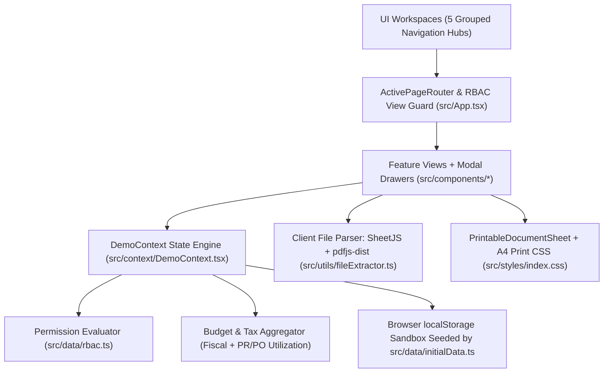

# OpenProcure — Public APP-CSE & Procurement RBAC Sandbox Demo


An interactive, client-side **Annual Procurement Plan — Common-Use Supplies & Equipment (APP-CSE)** and public procurement workflow showcase built cleanly for demonstration and training purposes.

**Live Demo:** https://tofuwho.github.io/app-cse-public-demo/

> **Security & Sandbox Notice:** This public showcase runs **100% in your browser** using synthetic seed data and `localStorage` persistence. There is no backend server, no external API persistence, no real agency/institution data, and zero connection to any private repository.

---

## Repository Topics & Tags

`app-cse` · `procurement` · `rbac` · `react` · `typescript` · `vite` · `tailwindcss` · `inventory-management` · `budget-allocation` · `ppmp` · `purchase-request` · `purchase-order` · `file-extraction` · `sheetjs` · `pdfjs` · `print-stylesheet` · `mock-demo` · `github-pages`

---

## Key Capabilities

| Area | Implemented Features |
| :--- | :--- |
| **Role-Based Access Control (RBAC)** | 6 distinct staff personas (`SUPER_ADMIN`, `BUDGET_OFFICER`, `PROCUREMENT_OFFICER`, `SUPPLY_CUSTODIAN`, `DEPT_USER`, `HOPE_APPROVER`), role switcher in the top bar, interactive Role × Module Permission Matrix, inline view-only notices, and an immutable activity audit log (`AuditLogEntry[]`). |
| **Fiscal Planning & Calculators** | Multi-year agency ceilings (MOOE & Capital Outlay), configurable contingency buffers, per-department budget allocations, live `Planned / Obligated / Utilized / Remaining Free` calculations, and an interactive VAT + Withholding Tax (EWT) purchase impact simulator. |
| **PPMP & Consolidated APP-CSE** | Departmental quarterly procurement plans (`Q1–Q4`) with draft → submit → verify → approve/return lifecycle, automatic roll-up of verified/approved plans into the agency-wide APP-CSE schedule, CSE vs. Non-CSE filtering, and Excel export. |
| **Inventory & Ledger** | Real-time warehouse catalog with reorder threshold alerts, stock adjustments with audit notes, and automated `STOCK_IN` (PO delivery receiving) and `STOCK_OUT` (SR issuance) movement history. |
| **Step-by-Step Procurement Flow** | Guided progression from **Inventory Check** → **Stock Requisition (SR)** with shortfall escalation → **Purchase Request (PR)** with Funds Certification & HOPE Approval → **Purchase Order (PO)** with VAT/EWT calculations, amount-in-words, and warehouse receiving. |
| **Allowed File Upload & Extraction** | 3-step client-side extraction wizard supporting `.xlsx`, `.xls`, `.csv`, `.tsv`, `.json`, `.txt`, and `.pdf` (10 MB cap). Features extension validation, auto-detected + manual column mapping, downloadable `.xlsx`/`.csv` templates, inline row editing, and 1-click injection into PPMP, Inventory, SR, PR, PO, or Print Studio. |
| **Form Generator & Physical Printing** | Side-by-side **Form & Print Studio** plus per-document print modals powered by dedicated A4 portrait `@media print` CSS rules (`src/styles/index.css`) for paper filing or browser Print-to-PDF. |

---

## Tech Stack

- **UI Framework:** React `18.3.1` + TypeScript `5.7.2`
- **Build & Tooling:** Vite `6.0.5` (`@vitejs/plugin-react`), configured with relative `base: './'` for static hosting
- **Styling & Icons:** Tailwind CSS `3.4.17` (`autoprefixer`, `postcss`), `lucide-react` `^0.468.0`
- **Spreadsheet & Document Parsing:**
  - `xlsx` (SheetJS `^0.18.5`) for `.xlsx` / `.xls` workbook parsing and `.xlsx` export
  - `pdfjs-dist` (`^4.8.69`, bundled Web Worker via Vite `?url` import) for client-side PDF table/text extraction
- **State Persistence:** React Context + `localStorage` (`openprocure_app_cse_demo_v1`) with 1-click demo data reset
- **Printing:** Browser-native `@media print` layout (`A4 portrait`, `.no-print`, `.print-container`, `.print-avoid-break`)

---

## Architecture & UX Design

### High-Level Architecture



### UI Separation & Decluttered Navigation

To keep procurement workflows clear even for first-time officers, modules are organized into **5 workspace hubs** with contextual sub-tabs and modal detail/creation drawers:

1. **Home & My Tasks** (`dashboard`): Welcome context, clickable 5-step procurement guide, 3 summary KPIs, `"Needs Attention Now"` queue, and department budget bars.
2. **Planning & Budgets** (`fiscal`, `ppmp`, `app_cse`): Budget allocations/calculator/ceilings (tabbed), PPMP master table + detail modal, and Consolidated APP-CSE schedule.
3. **Supply & Procurement** (`inventory` → `sr` → `pr` → `po`): Numbered horizontal step bar guiding users sequentially from stock check to supplier PO receiving, using clean master tables with centered creation and inspection modals.
4. **Import & Print** (`upload`, `print`): Guided 3-step file extraction wizard (with collapsible advanced column mapper) and a tabbed Form & Print Studio paired with a live sheet preview.
5. **Roles & Audit** (`rbac`): Cleanly separated into `Switch Demo Role`, `Permission Matrix`, and `Activity Log` tabs.

### Project Directory Structure

```text
.
├── index.html
├── package.json
├── tailwind.config.js
├── tsconfig.json / tsconfig.app.json / tsconfig.node.json
├── vite.config.ts
├── public/
│   └── .nojekyll
└── src/
    ├── App.tsx                             # Root router & module-level RBAC view guard
    ├── main.tsx                            # React 18 entry point
    ├── vite-env.d.ts
    ├── styles/
    │   └── index.css                       # Tailwind entry + A4 @media print stylesheet
    ├── types/
    │   └── procurement.ts                  # Domain interfaces & workflow status union types
    ├── data/
    │   ├── rbac.ts                         # 6 Role definitions, module metadata, permission matrix
    │   └── initialData.ts                  # Synthetic seed FYs, departments, SKUs, PPMP/SR/PR/PO
    ├── context/
    │   └── DemoContext.tsx                 # Centralized state, RBAC enforcement, totals & actions
    ├── utils/
    │   ├── fileExtractor.ts                # File validation, CSV/TSV/JSON/XLSX/PDF extraction & mapping
    │   └── formatters.ts                   # Currency, number, date, ID & amount-in-words helpers
    └── components/
        ├── Layout.tsx                      # 5-workspace shell, top bar switchers, toast stack
        ├── Modal.tsx                       # Reusable Escape/backdrop dialog for forms & details
        ├── RbacBadge.tsx                   # Calm view-only RBAC notices, RolePill & StatusBadge
        ├── PrintableDocumentSheet.tsx      # Standardized A4 form renderer & print preview modal
        ├── Dashboard.tsx                   # Guided overview, 5-step strip & attention feed
        ├── FiscalBudgetPage.tsx            # Department allocations, ceilings setup & VAT/EWT sim
        ├── PpmpAppCsePage.tsx              # Department PPMP master/detail & Consolidated APP-CSE
        ├── InventoryPage.tsx               # Stock catalog, adjustments & Stock In/Out ledger
        ├── StockRequisitionPage.tsx        # SR issuance & automatic shortfall-to-PR escalation
        ├── PurchaseRequestPage.tsx         # PR 4-stage stepper, funds certification & PO conversion
        ├── PurchaseOrderPage.tsx           # Direct/linked POs, EWT breakdown & warehouse receiving
        ├── FileUploadExtractPage.tsx       # 3-step file upload/paste extraction & target injector
        ├── PrintFormStudio.tsx             # Tabbed live form builder + print preview
        └── RbacAuditPage.tsx               # Role cards, live permission toggle grid & audit log
```

---

## RBAC Personas & Document Lifecycles

### Built-in Demo Roles

| Role ID | Persona | Primary Responsibilities |
| :--- | :--- | :--- |
| `SUPER_ADMIN` | Alex Mercer | Full access across all workspaces, fiscal configuration, and live RBAC policy editing. |
| `BUDGET_OFFICER` | Morgan Reyes | Configures FY ceilings, allocates department MOOE/CO budgets, verifies PPMPs, certifies PR funds. |
| `PROCUREMENT_OFFICER` | Taylor Santos | Consolidates APP-CSE schedules, manages PRs, converts approved PRs to POs, issues POs. |
| `SUPPLY_CUSTODIAN` | Jordan Navarro | Manages inventory catalog, adjusts physical counts, issues SRs, receives PO deliveries into stock. |
| `DEPT_USER` | Casey Lim | Scoped to a selectable department; creates PPMPs, Stock Requests (SR), PRs, file imports, and prints forms. |
| `HOPE_APPROVER` | Riley Cruz | Reviews utilization and grants executive final approval on PPMPs, APP-CSE, and PRs. |

### Workflow State Transitions

- **PPMP:** `Draft` / `Returned` → `Submitted` → `Budget Verified` → `Approved`
- **Stock Requisition (SR):** `Draft` / `Submitted` → `Approved & Issued` *(deducts stock)* **OR** `Needs Purchase (PR)` *(1-click converts shortfall into PR)*
- **Purchase Request (PR):** `Draft` / `Returned` → `Submitted` → `Funds Certified` → `Approved` → `Converted to PO`
- **Purchase Order (PO):** `Draft` → `Approved & Issued` → `Delivered / Received` *(auto-records `STOCK_IN` movement in Inventory)*

---

## Local Development

Requirements: **Node.js 20+** and **npm**.

```bash
# Install dependencies
npm install

# Start Vite development server
npm run dev

# Type-check and build production bundle into dist/
npm run build

# Preview production bundle locally
npm run preview
```

---

## GitHub Pages Deployment

Production static assets (`dist/`, including `.nojekyll` and relative `./assets/...` paths via `base: './'` in `vite.config.ts`) are served from the `gh-pages` branch at **https://tofuwho.github.io/app-cse-public-demo/**.

### Manual Update (`gh-pages` Branch)

```bash
npm run build
# Publish the contents of dist/ (plus public/.nojekyll) to the gh-pages branch
```

### Optional GitHub Actions Workflow

If using GitHub Actions (`Settings → Pages → GitHub Actions`), create `.github/workflows/deploy.yml` on `main`:

```yaml
name: Deploy APP-CSE Public Demo to GitHub Pages

on:
  push:
    branches: ['main']
  workflow_dispatch:

permissions:
  contents: read
  pages: write
  id-token: write

jobs:
  build:
    runs-on: ubuntu-latest
    steps:
      - uses: actions/checkout@v4
      - uses: actions/setup-node@v4
        with:
          node-version: '20'
          cache: 'npm'
      - run: npm ci
      - run: npm run build
      - uses: actions/upload-pages-artifact@v3
        with:
          path: './dist'
  deploy:
    environment:
      name: github-pages
      url: ${{ steps.deployment.outputs.page_url }}
    runs-on: ubuntu-latest
    needs: build
    steps:
      - id: deployment
        uses: actions/deploy-pages@v4
```
